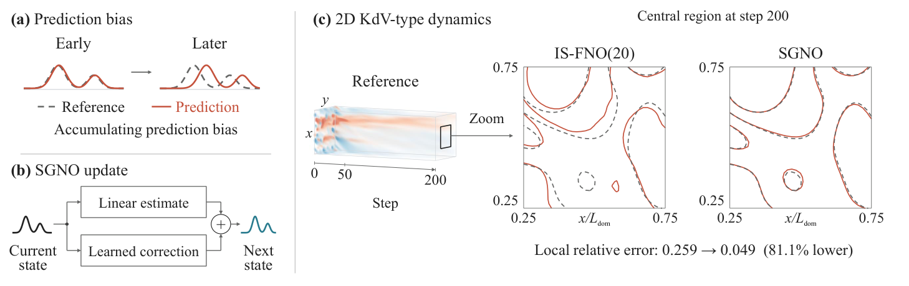
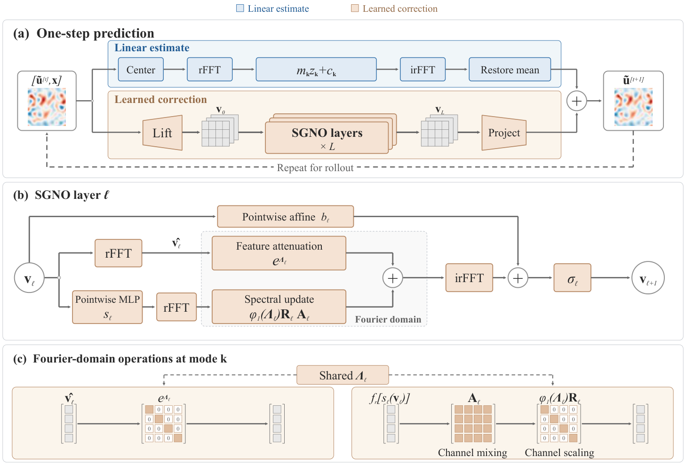
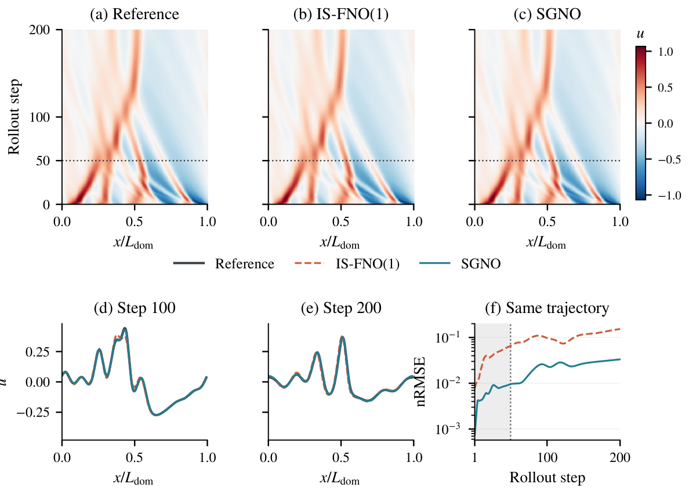
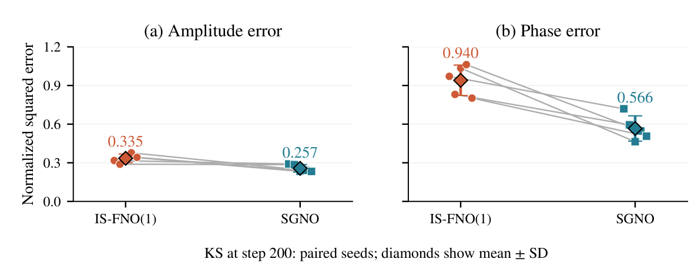

# SGNO

**Spectral Generator Neural Operator for Long-Horizon PDE Prediction**

Official code release accompanying the paper. SGNO combines a Fourier-domain
linear estimate fitted from adjacent training states with a learned nonlinear
correction. The predictor is trained on one-step targets and applied recursively
for long-horizon prediction. Both branches are trained jointly toward the same
next-state target.



**Figure 1.** (a) Accumulating prediction bias. (b) The SGNO update combines a
linear estimate with a learned correction. (c) A 2D KdV-type example at step
200. Dashed gray contours show the
reference and solid red contours the prediction. Relative L2 error in the
outlined central region is 0.259 for IS-FNO(20) and 0.049 for SGNO. This is an
illustrative trajectory from an additional 2D configuration, distinct from
the 1D KdV task in the main comparison.

## Architecture



The input is centered, advanced by a fitted affine spectral map, and combined with
the output of the SGNO correction network. The input mean is then restored. The
linear multiplier is parameterized as `exp(-rho**2 + 1j * omega)`. Its initialization
uses training pairs only; it does **not** use analytic PDE coefficients or test
trajectories. The correction network uses Fourier feature attenuation, nonlinear
spectral updates, and pointwise mixing. Its output head starts at zero. Both parts
are subsequently optimized together.

| Spatial dimension | Grid | Width | Modes | Layers | Parameter elements |
|---|---|---:|---:|---:|---:|
| 1D | 160 | 11 | 26 | 7 | 30,683 |
| 2D | 64 × 64 | 5 | 10 | 9 | 58,708 |
| 3D | 32 × 32 × 32 | 10 | 6 | 2 | 210,966 |

Complex parameter elements count once. These are the configurations used in the
main comparison. The correction is added to the fitted estimate of the next
state, and the resulting prediction becomes the next input.

## Paper results

The main comparison covers **13 periodic PDE configurations in one to three
dimensions**: nine linear and four nonlinear cases. Training trajectories contain
50 transitions; evaluation recursively predicts 200 steps from unseen initial
conditions. The main table uses **median GMean100 over five training runs**.
GMean100 is the geometric mean of the trajectory-averaged nRMSE over steps 1–100.

The nonlinear part of the main table is:

| Task | FNO | CNO | KNO | IS-FNO(1) | SGNO |
|---|---:|---:|---:|---:|---:|
| KdV (1D) | 0.194 | 0.473 | 0.0908 | 0.0466 | **0.0122** |
| KS (1D) | 0.516 | 0.360 | 0.307 | 0.0800 | **0.0512** |
| Burgers (1D) | 0.0185 | 0.293 | 0.0196 | 0.00584 | **0.00334** |
| Kolmogorov (2D) | 0.666 | 0.494 | 0.976 | 0.552 | **0.430** |

SGNO reduces median GMean100 by approximately 13–74% relative to the strongest
baseline under the main comparison protocol on each nonlinear task. The linear
tasks examine recovery of the numerical state update. See the
[complete main table](results/main_comparison.tex),
[all run-level scores](results/paper/main_seed_scores.csv), and
[result guide](results/README.md) for the full comparison and additional protocols.

## Install

Use Python 3.10 or newer for model training and evaluation. Install a PyTorch build
appropriate for your hardware, then run from this directory:

```bash
python -m venv .venv
source .venv/bin/activate
python -m pip install -e ".[test]"
python -m pytest -q
```

On Windows, activate with `.venv\Scripts\Activate.ps1`. The release's CPU checks
were run with Python 3.12, PyTorch 2.5.0, and NumPy 2.1.2. GPU execution is selected
automatically when CUDA is available; pass `--device cpu` to use the CPU.

## Generate data

Data generation uses a **separate Python 3.11 environment** with the numerical
dependencies pinned in `requirements-data.txt`. This keeps the reference solver
environment separate from PyTorch. From the repository root:

```bash
python3.11 -m venv .venv-data
source .venv-data/bin/activate
python -m pip install -r requirements-data.txt
git clone https://github.com/Ceyron/apebench.git third_party/apebench
git -C third_party/apebench checkout dca24a00eeacbe5524a99542f6d5c2bc2deb8da8
python -m pip install -e third_party/apebench --no-deps
python scripts/generate_data.py --task kdv1d --apebench-repo third_party/apebench --out data/kdv1d.npz
```

The generator checks the pinned APEBench checkout. Task-specific numerical
settings, initial conditions, and split seeds are encoded in
`src/sgno/data_generation/`; `configs/tasks.json` lists the model-facing shapes.
Generated arrays have shape `(trajectory, time, channel, *spatial_grid)`.

| Group | Task IDs |
|---|---|
| Linear, 1D | `adv1d`, `diff1d`, `disp1d` |
| Linear, 2D | `mixdisp2d`, `anisodiff2d_axis`, `anisodiff2d_rot45` |
| Linear, 3D | `diagdiff3d`, `unbaladv3d`, `advdiff3d` |
| Nonlinear, 1D | `kdv1d`, `ks1d`, `burgers1d_nu12e4` |
| Nonlinear, 2D | `kolm2d` |

Replace `kdv1d` in the command with any listed task. Each training set contains
50 trajectories with 50 adjacent transitions. Evaluation uses all test initial
conditions: 30 for 1D/2D and 10 for 3D. Some generators store trajectories longer than 200 steps;
the commands below evaluate the first 200 transitions. Full datasets and
pretrained benchmark checkpoints are not bundled.

## Train and evaluate

Activate the PyTorch environment again. A complete single-seed run is:

```bash
python scripts/train.py --task kdv1d --data data/kdv1d.npz --seed 0 --out runs/kdv1d/seed0
python scripts/evaluate.py --data data/kdv1d.npz --checkpoint runs/kdv1d/seed0/checkpoint.pt --out runs/kdv1d/seed0/evaluation
```

Training uses 10,000 Adam updates, batch size 20, 2,000 warm-up updates, peak
learning rate 0.001, and a cosine schedule. The objective is next-state MSE.
The final checkpoint is used without test-based model selection. To continue
an interrupted run, repeat the training command with `--resume`.

Run seeds `0, 1, 2, 3, 4` separately. On a POSIX shell:

```bash
for seed in 0 1 2 3 4; do
  python scripts/train.py --task kdv1d --data data/kdv1d.npz --seed "$seed" --out "runs/kdv1d/seed$seed"
  python scripts/evaluate.py --data data/kdv1d.npz --checkpoint "runs/kdv1d/seed$seed/checkpoint.pt" --out "runs/kdv1d/seed$seed/evaluation"
done
python scripts/aggregate.py --runs runs --out results/recomputed.csv
```

Evaluation starts from the reference initial condition and recursively feeds back
predictions without reference resets. It saves all per-trajectory errors,
the first trajectory's fields, and summaries for steps 1–100 and 101–200.
Aggregation requires all five seeds and reports the median, mean, sample standard
deviation, and individual values A–E, matching the paper's compact and detailed
tables. Non-finite groups are marked `NF`.



**Figure 3.** Qualitative comparison over a 200-step KdV rollout. Top: reference,
IS-FNO(1), and SGNO on a common color scale. Bottom: profiles at steps 100 and 200
and the same trajectory's nRMSE. Dotted lines and gray shading mark the
50-transition training span. Complete statistics, including late-window nRMSE
slopes, are in [the long-horizon records](results/paper/temporal_seed_scores.csv).

## Component ablations

Add the following options to the training command and use a separate output
directory for each configuration:

| Setting | Options |
|---|---|
| SGNO | `--corrector sgno --outer fitted_joint` (default) |
| Identity outer map | `--outer identity_fixed` |
| Direct spectral multiplier, identity initialization | `--outer direct_identity` |
| Direct spectral multiplier, fitted and frozen | `--outer direct_fitted_frozen` |
| Direct spectral multiplier, fitted and trainable | `--outer direct_fitted` |
| Remove nonlinear spectral update | `--component no_nonlinear_spectral_update` |
| Remove local pointwise path | `--component no_local_pointwise_path` |

These settings correspond to the initialization/adaptation and layer-path
comparisons in Section 5.2. The removed local path is the pointwise affine map
inside a correction layer. Evaluation restores the configuration saved in each
checkpoint automatically. [Full ablation records](results/paper/ablation_seed_scores.csv)
include every training run for the reported settings.

## Amplitude and phase diagnostics



**Figure 4.** Amplitude and amplitude-weighted phase contributions to normalized
squared field error on KS at step 200. Each point averages all 30 test initial
states for one training run. Gray lines connect paired runs; diamonds and error
bars show the mean and sample standard deviation across five runs. The mean
components decrease from 0.335 to 0.257 and from 0.940 to 0.566, respectively.

`evaluate.py` saves these per-field endpoint components, the predicted-to-reference
squared-norm ratio, and the normalized field inner product. Definitions and
aggregation are documented in [reproduction notes](docs/REPRODUCIBILITY.md).
Recorded figure values are in [the KS data](results/paper/ks_endpoint_phase_values.csv).

## Additional resolution-transfer study

A separate 2D KdV-type experiment freezes five models trained on 64×64 and tests
32×32 and 128×128 without retraining. It compares direct frequency-based adaptation
with Fourier resampling through the training grid. The complete 25 run/configuration
records, reference checks, and extension convention are in the
[resolution-transfer note](docs/RESOLUTION_TRANSFER.md). This study is additional
to the paper's 13-configuration main comparison.

## Repository guide

```text
src/sgno/           SGNO implementation, matched controls, and metrics
src/sgno/data_generation/  Pinned reference-data generators
scripts/           Data generation, training, rollout evaluation, aggregation
configs/           Thirteen tasks and the five-seed training protocol
tests/             Model, constraint, and metric checks
results/           Paper tables, complete run statistics, additional transfer study
assets/            Paper figures used in this README
docs/              Implementation and reproduction notes
```

See [reproduction notes](docs/REPRODUCIBILITY.md) for precision settings, metric
definitions, and the distinction between recorded comparisons and newly computed
results. The release contains the complete SGNO model and its data, training,
evaluation, and controlled-ablation pipeline. The external FNO, CNO, KNO, and IS-FNO
main-baseline training pipelines are not vendored; the paper describes their respective
protocols. Dependencies and attribution are listed in [THIRD_PARTY.md](THIRD_PARTY.md).

## License

The released code is distributed under the [MIT license](LICENSE).
